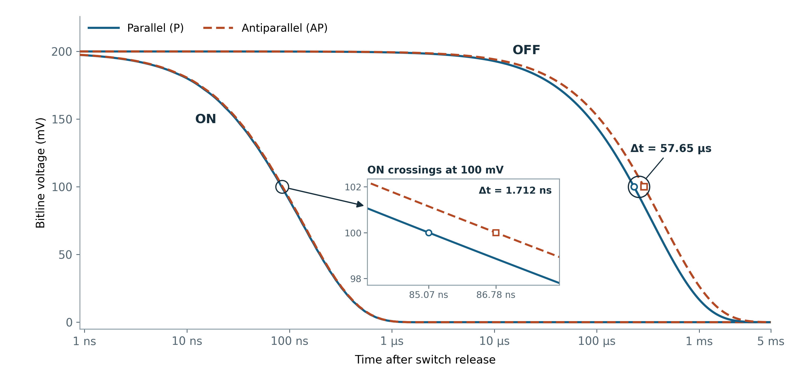
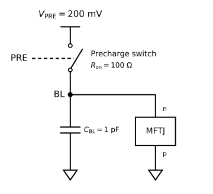

# MFTJ bitline discharge in Cadence Spectre

This four-cell read circuit demonstrates an equation-based Verilog-A compact model of a multiferroic tunnel junction (MFTJ). The model calculates the spin-dependent tunneling current at the instantaneous junction voltage. The example uses an Fe₃GeTe₂ / CuInP₂S₆ / Fe₅GeTe₂ junction at 120 K.



The main traces and the inset come from a single 5 ms Spectre transient. [Download the vector figure](figures/mftj_bitline_discharge_5ms.svg).

## Circuit



Each cell has a 1 pF bitline capacitor, a 100 Ω precharge switch connected to a 200 mV supply, and a junction with an assumed area of 1.99 µm². The junction model includes its geometric capacitance. Spectre first solves the DC operating point with the switches closed. At 1 ns the switches open, and each bitline discharges through its junction.

The four instances hold their polarization and magnetic alignment fixed during readout. The parameter `initial_sign` selects ON (+1) or OFF (−1). The parameter `alignment` selects parallel (+1) or antiparallel (−1). The read delay is the elapsed time from switch release to the first falling 100 mV bitline crossing.

## Run the example

Use a Linux shell with a licensed Cadence Spectre installation and its Verilog-A compiler available. Run the commands from the repository root. The [5 ms deck](rc_discharge.scs) loads the local [Verilog-A model](mftj_equations.va).

```bash
spectre rc_discharge.scs -format psfascii -raw rc_discharge_results +log rc_discharge.log
cat rc_discharge.measure
```

The deck measures all four 100 mV crossings, both P–AP delay gaps, and the OFF states' 1 mV settling times. It uses a relative tolerance of 10⁻³, with a maximum time step of 500 ps from 65 to 100 ns and 50 µs after 350 µs.

## Reference results

The reference run used Spectre 25.1.0.470.isr13, finished in 42.5 seconds of wall time on the reference machine, and accepted 251 transient steps.

| State | Delay to 100 mV |
|---|---:|
| ON/P | 84.668 ns |
| ON/AP | 86.387 ns |
| OFF/P | 230.806 µs |
| OFF/AP | 288.476 µs |

The figure shows a P–AP delay gap of **1.71 ns** in the ON state and **57.67 µs** in the OFF state.

## Regenerate the figure

After the run, use Python 3 with NumPy and Matplotlib installed. The script reads the PSF ASCII waveform and Spectre measurements and writes the PNG and SVG to `figures/`.

```bash
python3 plot_discharge.py
```

Experimental device data used for calibration are reported by Xie et al., Fig. 3. [Nature Nanotechnology, DOI 10.1038/s41565-025-02065-1](https://doi.org/10.1038/s41565-025-02065-1).
